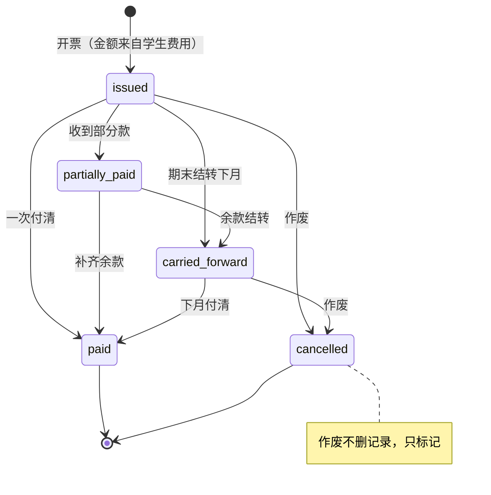
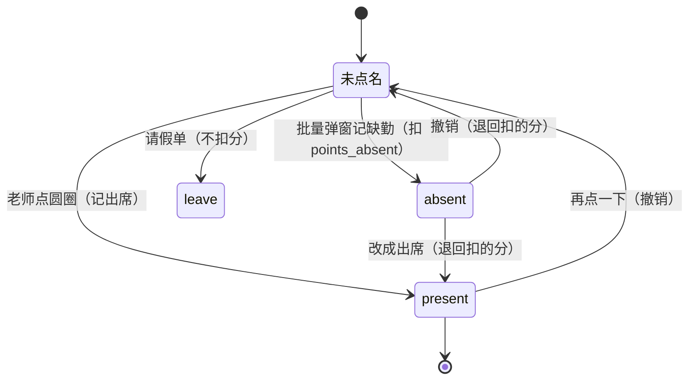
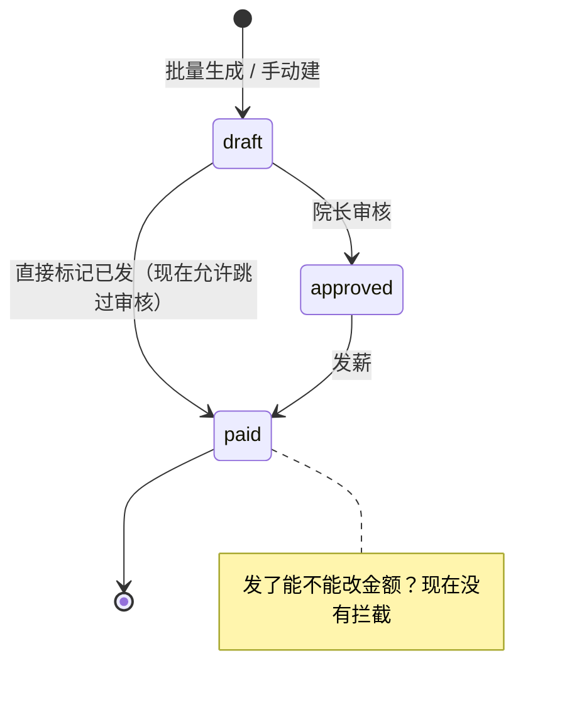
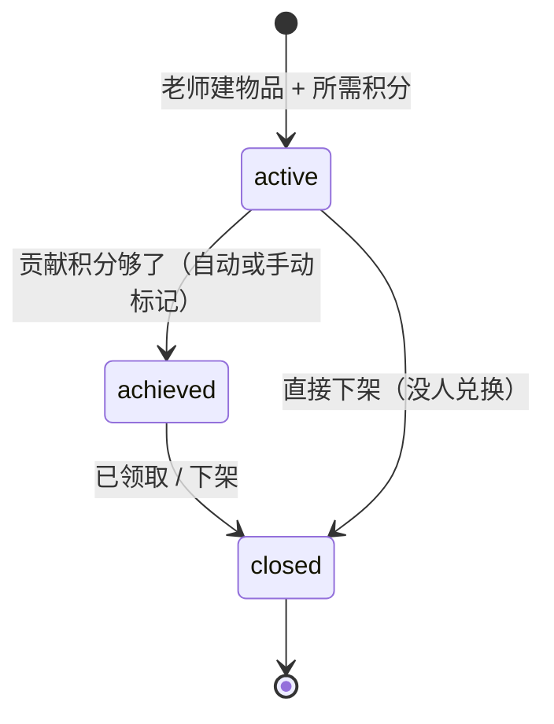
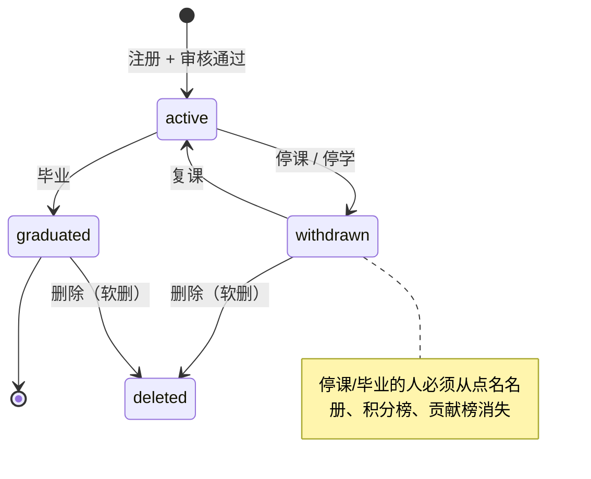

# PJPC 状态图（Mermaid 原文）

> 这些图描述的是**系统里真实存在的状态值**（直接从 PocketBase 查出来的），不是示意。
> 改流程时改这里，图能进 git，改动看得见。
> 判定方法：先查 `select` 字段的 values + 实际出现过的值，再画。

字段取值来源（2026-11-19 实测）：

| 对象 | 集合.字段 | 实际值 |
|------|-----------|--------|
| 发票 | `invoices.status` | `unpaid` 178 → 实为 `issued` 178·`paid` 265·`carried_forward` 51·`partially_paid` 4·`unpaid` 1·`cancelled` 3 |
| 收据 | `receipts.status` | `issued` 334 |
| 点名 | `roll_call.status` | `present` / `absent` / `leave` |
| 工资 | `teacher_salary_records.status` | `draft` / `approved` / `paid`（库里现有 draft 5、paid 132，approved 0） |
| 贡献物品 | `contribution_items.status` | `active` / `achieved` / `closed` |
| 学生 | `students.status` | `active` 119 / `withdrawn` 25 / `deleted` 3（另有 select 值 `graduated`） |

---

## 1. 发票状态（state diagram）



**三个没有出口的洞（画图时发现的）：**

1. **`paid` 之后没有出口** —— 家长多付了怎么办？现在只能走 `student_credits`（抵扣）或退款，但发票本身不动 → 账面对不上。
2. **`cancelled` 之后没有出口** —— 已作废的票如果家长已经付过钱，钱挂在哪？图里没有路径。
3. **`carried_forward` 到底算不算欠款？** —— 51 张结转票，催收名单要不要包含它们现在没定义。

---

## 2. 点名状态（state diagram）



**这里的规矩（代码里已经这样实现的）：**

- `fabsent → present` 必须**把扣掉的分退回**，判断「到底扣着没有」用当天 `reason~"缺勤"` 的**净额**求和，不能用关键词查存在性
- `点一下撤销` = 删掉当天那条记录，不是写一条空行
- 学生状态 `withdrawn` / `graduated` 的人**根本不该出现在名册**（源头过滤，不是页面上再写一遍）

---

## 3. 工资发放状态（state diagram）



**两个洞：**

1. **`paid` 之后能否改金额/扣款？** —— 现在是「能」，`/api/teacher-salary` 没有对 `status='paid'` 做写入拦截。发过的工资被人改了，账会静默错。
2. **`approved` 在库里 0 条** —— 说明这个中间态没人用，审核等于没做。要么删掉这一态，要么在 UI 里真的加上审核按钮。

---

## 4. 贡献物品状态（state diagram）



**要确认的：**

- `achieved` 之后如果学生放弃领取，能不能退回 `active`？现在没有这条线。
- `closed` 的物品，学生的贡献分要不要退？图里没有出口。

---

## 5. 学生状态（state diagram）



**这条最容易出事：**

- `inactive` **不是**真实取值 —— 写 `!== 'inactive'` 等于没过滤（25 个停课学生就会留在名册上，而且年级是空的，页面多出一整块「未分年级」）
- 判据永远是：先 `select status, count(*) group by status` 看真实值，再写条件
- 子记录（报告 / 费用 / 发票）不会跟着父状态变，列表要按父记录**当前** status 过滤

---

**怎么改这些图：** 直接改本文件的 mermaid 代码块，然后 `git commit`。要重新检查真实状态值，跑：

```bash
# 换成对应集合和字段
curl -s "http://127.0.0.1:8090/api/collections/invoices/records?perPage=500&fields=status" \
  -H "Authorization: <PB token>" | jq -r '.items[].status' | sort | uniq -c
```
